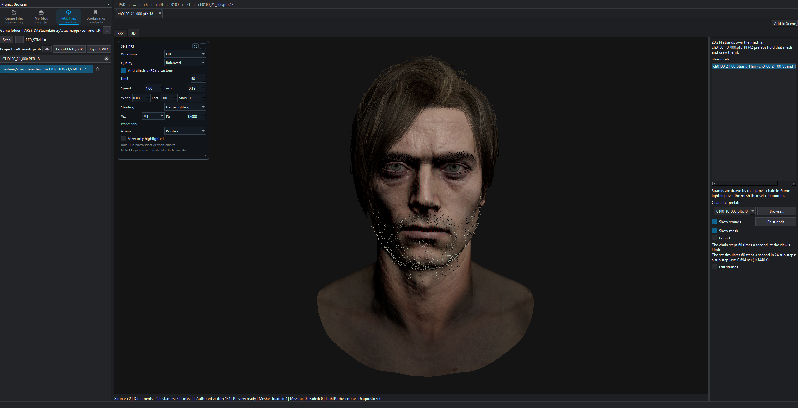
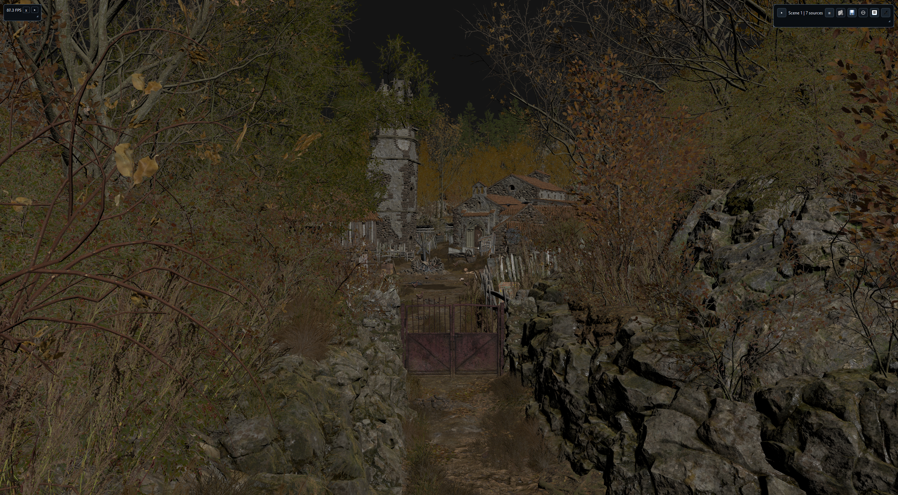

  

  A file editor and modding toolkit for RE Engine games.

  
  
  

<table>
  <tr>
    <td></td>
    <td></td>
  </tr>
  <tr>
    <td align="center">Hair strands in a prefab's 3D tab</td>
    <td align="center">A scene drawn with the game's shaders</td>
  </tr>
</table>

REasy opens, edits and repacks the files used by Capcom's RE Engine. It covers RE2, RE3 and RE7 (RT and non-RT), RE4, RE8, RE9, RE Resistance, DMC5, SF6, MH Rise, MH Wilds, MH Stories 3, Dragon's Dogma 2, Onimusha: Way of the Sword, Pragmata, Kunitsu-Gami, Dead Rising Deluxe Remaster and O2.

The interface is available in English, Chinese, Russian and Spanish.

## What it does

- **SCN, PFB and USER editing** for every RSZ version since RE7. Copy and paste GameObjects, components and array items between files, save GameObjects as templates, or grab templates other people shared from the community browser.
- **3D viewer** for meshes and scenes, with a Game lighting mode that draws them with their real shaders.
- **Mesh conversion** between games, and a Blender round trip.
- **Material editing**, from MDF values down to master materials (MMTR) as a node graph.
- **Hair strand editing** for RE9 and Pragmata.
- **PAK tools**: fast extraction (whole archives or single files, with regex search) and packing.
- **Projects**: build a mod and export it as a PAK or a Fluffy Mod Manager zip (*File > Create Project*).
- **Search** across folders for text, numbers, GUIDs or RSZ field values.
- **Diff viewer** for SCN files, and a detector for RSZ files outdated by game updates (*Tools*).
- **AI assistant** (optional) using DeepSeek or a local OpenAI-compatible server such as LM Studio. It can browse projects, tabs and PAKs and edit MDF and MSG files. Your messages and the editor context it asks for are sent to the provider you pick.

## Supported files

- **Edit:** SCN, PFB, USER, UVAR, RCOL, CFIL, MSG, UVS, MDF, MMTR,  SDFTEX (baked from a mesh), DDS (to TEX), SDF, MESH, TEX, MOTBANK, MCAMBANK, CLIP, TML, UCURVE, GUI, BNK, PCK, WEL, WCC and other headless sound files, hair strands
- **View:** FOL, STMESH, GCF, IFT, OFT, MOTLIST, light probes (in SCN scenes)
- **Other:** PAK through *Tools > PAK Browser*, MOV in your default video player

Game limits

- **MESH**: view only for RE7, RE7 RT, O2, MH Stories 3, Kunitsu-Gami and one older RE3/Resistance version; DRDR meshes don't open.
- **MMTR, SDF**: not RE7 non-RT. Older DD2 and the Onimusha demo: pixel shaders only.
- **RCOL**: not RE7 non-RT (rcol.2) or MH Wilds rcol.38.
- **Hair strands**: edit in RE9 and Pragmata, view in RE4.
- **GUI, MOTLIST**: DMC5 only.
- **WEL**: RE2, RE3, RE7 RT, RE8, DMC5, MH Rise.
- **BNK, PCK**: no audio replacement for RE7 non-RT, RE Resistance, MH Stories 3, O2, Kunitsu-Gami or DRDR.
- **Light probes**: not RE7 non-RT, RE Resistance or DRDR.
- **STMESH**: RE4, SF6, MH Wilds, DD2, Onimusha, Pragmata.
- **SDFTEX**: RE4, MH Wilds, DD2, Onimusha, Pragmata, RE9.
- **CLIP, TML, UCURVE**: tested up to MH Wilds.

The list follows the source code; the latest release may be behind.

## Getting started

Grab the latest build from [Releases](https://github.com/seifhassine/REasy/releases/latest) and run `REasy.exe`.

REasy downloads the tools some features need into its `downloads` folder the first time you use them, after asking: the DirectX Shader Compiler and SPIR-V Tools (shader editing), vgmstream (sound preview), REE.Packer (PAK export) and Blender (.blend export and import). If a download fails, REasy names the page to get the tool from and the folder to put it in. Replacing game audio needs the Wwise version REasy names for that game, installed from [Audiokinetic](https://www.audiokinetic.com/en/download/).

To run from source on Windows you need Python 3.15 (`py -3.15 --version` should work), Git, and the [Microsoft C++ Build Tools](https://visualstudio.microsoft.com/visual-cpp-build-tools/) with the "Desktop development with C++" workload, which includes the Windows SDK (10.0.20348 or newer; the current Windows 11 SDK works). The SDK is the C++ one with the Direct3D 12 headers, not .NET. Running a release `REasy.exe` needs neither.

- `run_reasy.bat` sets up `.venv` on first launch and starts REasy.
- `build.bat` builds a standalone `REasy.exe` into `dist`.

The first setup fetches and compiles the native GDeflate sources, so it needs network access. Later runs reuse the cache. If you'd rather launch `REasy.py` yourself, run `python setup.py build_ext --inplace` first.

On Linux, if REasy stops with "Aborted" on launch, install `libxcb-cursor0`.

## Guides

- [REasy Wiki](https://github.com/seifhassine/REasy-Wiki/blob/main/README.md) (work in progress)
- [Adding new flags to RE4R](https://www.nexusmods.com/residentevil42023/articles/346). Around 20k extra flags is safe; at 50k the game crashes on save.
- [Modding weapons and items in RE8](https://www.nexusmods.com/residentevilvillage/articles/45) by [matalayudasleazy](https://next.nexusmods.com/profile/matalayudasleazy?gameId=3669)

Up-to-date RSZ dumps for every game are in [resources/data/dumps](resources/data/dumps). RSZ files from most games are tested on every build.

## Contributing

PRs are welcome and I review them. AI-assisted contributions are fine as long as a human has reviewed them properly: keep the code clean, include correctness tests, and stick to one file format or submodule per PR.

## Credits

- [@alphazolam](https://github.com/alphazolam) for the 010 RE templates
- @TrikzMe for RE's MurmurHash3
- [@praydog](https://github.com/praydog) for the RSZ JSON dumps and REFramework
- @don for help with exe debugging
- @shadowcookie for advice and many updated file structures (REE Lib)
- @Ekey for the PAK decryption algorithms
- @NSACloud for older mesh format research (Now reworked)
- @brewedenhell for contributions to the [Wiki](https://github.com/seifhassine/REasy-Wiki/tree/main)

If you'd like to support development, you can do so [here](https://linktr.ee/seifhassine).

## License and use

REasy is released under the [MIT License](LICENSE.txt). It uses [PySide6](https://pypi.org/project/PySide6/) (Qt for Python) under the [LGPL v3](https://www.gnu.org/licenses/lgpl-3.0.html); see [Qt licensing](https://www.qt.io/licensing/). Release builds ship the license texts of every bundled component in `resources\licenses`, indexed by `THIRD-PARTY-NOTICES.txt`.

The REasy name and logo are covered by [TRADEMARKS.md](TRADEMARKS.md). They may not be used to credit REasy for sexually explicit or NSFW content, or for anything that breaks Capcom's terms.

REasy is meant for lawful modding, research and preservation, mainly in offline and single-player games. It does not support cheating, interfering with anti-cheat or online services, or distributing copyrighted material, and related issues or content may be removed from REasy's platforms. You are responsible for following the law and each game's terms. None of this changes the rights the MIT License grants.

REasy is an independent project and is not affiliated with or endorsed by Capcom.

## Sponsors

<table>
  <tr>
    <td align="center"></td>
    <td>Free code signing on Windows provided by <a href="https://signpath.io/">SignPath.io</a>, certificate by <a href="https://signpath.org/">SignPath Foundation</a></td>
  </tr>
</table>
